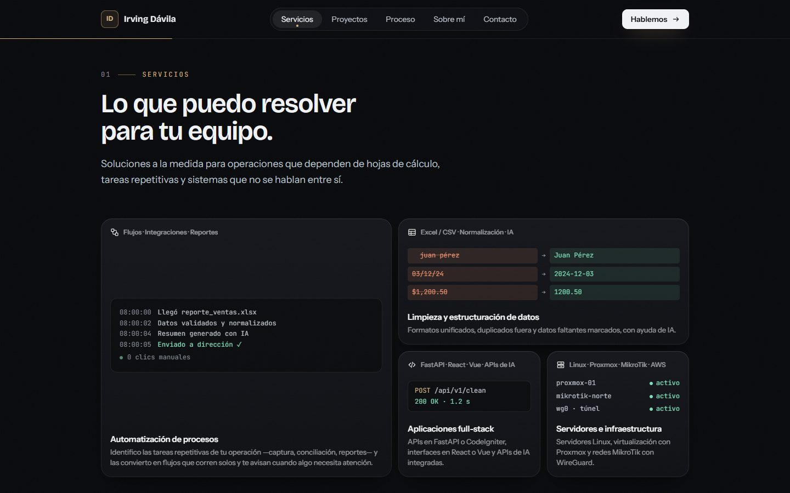
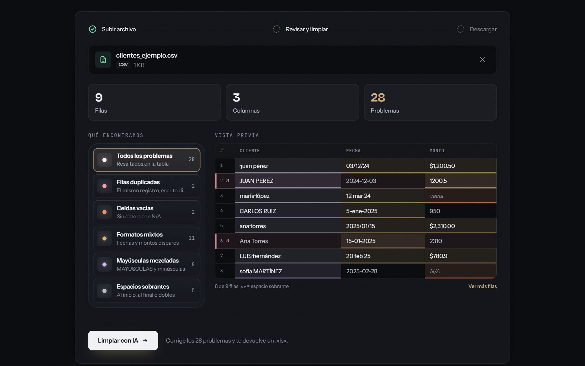
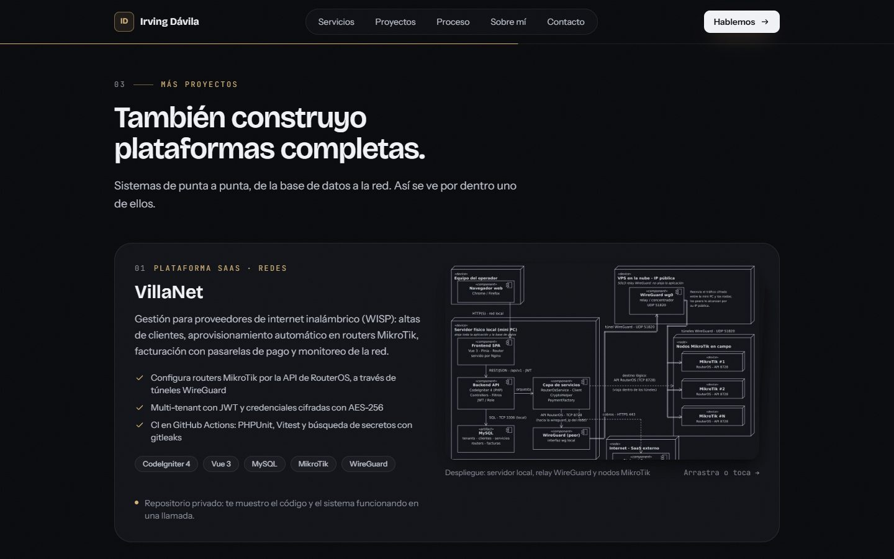

<div align="center">

# Irving Dávila — Portfolio

**Full-stack developer · AI automation.**
A bilingual (Spanish and English) portfolio that sells by showing: two live AI demos (data cleaning and an appointment agent), a 3D badge you can grab, and real projects.

[](https://github.com/IrvingDevv26/portfolio/actions/workflows/ci.yml)


</div>


> **Resumen en español.** Portfolio de Irving Dávila, desarrollador full-stack
> especializado en automatización con IA. Incluye dos demos en vivo:
> **DataRefine** (sube un Excel desordenado y recíbelo limpio) y **AgendaFlow**
> (un agente de IA que agenda, cambia y cancela citas), una credencial 3D
> interactiva, calculadora del costo del trabajo manual, proyectos reales y un
> brief de proyecto para contacto. Hecho con React 19, Vite, Tailwind CSS 4 y
> 40 componentes de React Bits. Ver [Resumen en español](#resumen-en-español).

| Services | Live demo | Projects |
| --- | --- | --- |
|  |  |  |

## Highlights

- **Live DataRefine demo** (`/demo/datarefine`): the file is diagnosed in the
  browser first (duplicates, empty cells, mixed formats, casing and spaces,
  highlighted cell by cell), then cleaned by the
  [DataRefine API](#related) and compared before and after. Public-demo limits
  are handled gracefully.
- **Live AgendaFlow demo** (`/demo/agenda`): a WhatsApp-style chat with an AI
  agent that books, reschedules and cancels appointments of a fictional
  clinic. Next to the chat, the clinic's calendar updates live and every tool
  the agent ran is listed, so visitors see what happens behind the
  conversation. Backed by the AgendaFlow API.
- **Interactive 3D badge** built with three.js and react-three-fiber, with a
  lightweight CSS fallback when the browser has no hardware WebGL.
- **Sales-oriented content**: manual-work cost calculator (in MXN or USD; it
  starts in pesos only for visitors in Mexico), case study with real numbers,
  process timeline, FAQ and a 3-step project brief.
- **Accessible and fast**: Lighthouse 100 for accessibility, best practices and
  SEO; 98 performance on desktop. `prefers-reduced-motion` is respected
  everywhere.
- **Bilingual**: Spanish at `/` and English at `/en` (`/en/demo/agenda`…),
  with an ES/EN switch, a gentle language hint for visitors whose browser uses
  the other language, `hreflang` links and per-language link previews. Both
  demo APIs answer in the page language (`?lang=en`).
- **All copy in one file per language**: every text, link and project lives in
  `src/content/es.js` and `src/content/en.js`, which share the same shape;
  `npm run check:content` (also in CI) fails if one of them is missing
  something.

## Tech stack

| Area | Tools |
| --- | --- |
| UI | React 19, React Router 7, Tailwind CSS 4, framer-motion |
| 3D | three.js, @react-three/fiber, @react-three/drei |
| Components | [React Bits](https://reactbits.dev) (adapted to the site palette) |
| Data | fflate (reads `.xlsx` in the browser for the demo preview) |
| Tooling | Vite 8, ESLint, GitHub Actions |

## Getting started

Requires Node.js 22 or newer.

```bash
npm install
cp .env.example .env     # Windows: copy .env.example .env
npm run dev              # http://localhost:5173
```

| Script | What it does |
| --- | --- |
| `npm run dev` | Development server |
| `npm run build` | Production build in `dist/` |
| `npm run preview` | Serves the production build |
| `npm run lint` | ESLint |

### Environment variables

| Variable | Purpose |
| --- | --- |
| `VITE_API_URL` | DataRefine API used by the data-cleaning demo (e.g. `http://localhost:8000`) |
| `VITE_AGENDA_API_URL` | AgendaFlow API used by the appointment agent demo (e.g. `http://localhost:8001`) |
| `VITE_SITE_URL` | Public site URL without trailing `/`, used for the canonical URL and social previews |

## Project structure

```
src/
  content/
    es.js, en.js        Every text, link, service and project, per language
  pages/
    Landing.jsx         Home page sections
    DataLab.jsx         DataRefine live demo
    AgendaLab.jsx       AgendaFlow live demo (AI appointment agent)
    NotFound.jsx        404 page
  components/
    reactbits/          React Bits components adapted to the site
    Lanyard.jsx         3D badge (three.js)
    SheetPreview.jsx    Demo preview table and detected problems
    ...
  lib/
    sheet.js            In-browser CSV/XLSX reader and diagnosis
    i18n.js             Language from the URL, useContent() and the ES/EN links
    hooks.js, gpu.js    Shared hooks and WebGL detection
  styles/
    GlobalStyles.jsx    Palette, fonts and global animations
public/                 Images, icons, social preview and manifest
```

## Performance

- Self-hosted fonts (Fontsource), no render-blocking Google Fonts CSS.
- Sections below the fold are lazy-loaded when they are about to be seen
  (`src/components/Deferred.jsx`) and use `content-visibility: auto`.
- The 3D badge mounts when the browser is idle and compiles its shaders in
  parallel; heavy WebGL effects in the demo are only created when needed.

## React Bits components

Adapted to the site palette and to `prefers-reduced-motion`, in
`src/components/reactbits/`:

| Component | Where |
| --- | --- |
| Lanyard | 3D badge in the hero |
| BlurText, RotatingText, ShinyText, GradientText, DecryptedText | Headlines, highlights and section labels |
| ScrollVelocity, ScrollReveal, AnimatedContent | Scroll-driven text and reveals |
| MagicBento | Services bento grid with mini visuals |
| ScrollExpand | Case study opening: the demo grows to full screen |
| CountUp, Counter, ElasticSlider | Case study numbers and cost calculator |
| Folder | Technical sheets of DataRefine |
| Stack, ScrollStack, GlareHover, PixelTransition | Projects section |
| TiltedCard, VariableProximity, BranchedMenu | About section |
| StatusMark, Stepper, ThoughtLine | Process timeline, project brief and demo steps |
| Squares, Crosshair | Backgrounds of contact and demo |
| ElectricBorder, AnimatedList, LatticeLoader | Live demo |
| StaggeredMenu, Magnet, StarBorder, ClickSpark | Navigation and buttons |
| SwipeToast, WarmTooltip, LogoLoop, CodeSlots, FuzzyText | Toasts, tooltips, stack logos, dev mode and 404 |

## Deployment

Static site, deployed on [Cloudflare Pages](https://pages.cloudflare.com):

| Setting | Value |
| --- | --- |
| Build command | `npm run build` |
| Output directory | `dist` |
| Environment | `VITE_API_URL`, `VITE_AGENDA_API_URL`, `VITE_SITE_URL` |

Client-side routes such as `/demo/datarefine` work out of the box: without a
top-level `404.html`, Pages serves the app for every path.

**Link previews per page and language.** Chat apps and social networks read
the HTML without running JavaScript, so a small Vite plugin (`vite.config.js`)
writes `dist/en.html`, `dist/demo/agenda.html`, `dist/en/demo/agenda.html`
and the DataRefine pair: copies of `index.html` with each page's language,
title, description, preview image (`public/og-*.jpg`) and `hreflang` links.
Pages serves them at `/en`, `/demo/agenda`, `/en/demo/agenda` and so on.

**Demo APIs awake in business hours.** Both APIs run on Render's free plan,
which sleeps after 15 minutes without traffic. The
[Keep demos awake](.github/workflows/keep-demos-awake.yml) workflow pings
them every 10 minutes, Monday to Friday from 8:00 to 20:00 (Mexico City),
using at most ~560 of the 750 free hours per month that Render shares across
the workspace. GitHub disables scheduled workflows after 60 days without
repository activity; re-enable it from the Actions tab if that happens.

## Related

- **DataRefine API** (private): FastAPI + pandas backend behind the
  data-cleaning demo, with deterministic cleaning rules, free AI providers
  with validation and caching, and public-demo limits.
- **AgendaFlow API** (private): FastAPI backend behind the appointment agent
  demo: LLM tool calling over validated scheduling rules, one sandboxed
  calendar per visitor and free AI providers.

## Resumen en español

- **Qué es:** el portfolio de Irving Dávila, en español (`/`) y en inglés
  (`/en`), pensado para vender servicios de automatización y desarrollo
  full-stack.
- **Lo más importante:** las dos demos en vivo. DataRefine
  (`/demo/datarefine`) diagnostica tu archivo en el navegador y luego lo limpia
  con el backend; AgendaFlow (`/demo/agenda`) es un agente de IA que agenda
  citas mientras ves la agenda actualizarse.
- **Siempre listas:** en horario laboral (lun–vie, 8:00–20:00 de CDMX) un
  workflow de GitHub Actions mantiene despiertas las APIs de las demos, y cada
  demo tiene su propia vista previa al compartir el enlace.
- **Cómo correrlo:** `npm install`, copia `.env.example` como `.env` y ejecuta
  `npm run dev`.
- **Dónde editar:** todos los textos, enlaces y proyectos están en
  `src/content/es.js` y su versión en inglés en `src/content/en.js` (con la
  misma forma; `npm run check:content` avisa si falta algo); la paleta y las
  animaciones globales en `src/styles/GlobalStyles.jsx`.

## License

© 2026 Irving de Jesús Dávila Torres. All rights reserved. The source code is
public for reference only; see [LICENSE](LICENSE). Third-party components keep
their own licenses (React Bits, Simple Icons, Fontsource fonts).
